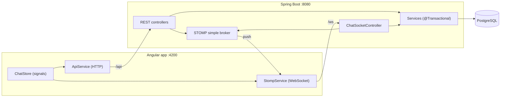

# AionChat

A real-time chat application built with **Spring Boot** and **Angular**. Users join with a username, chat in a shared room, and start direct or group chats. Messages, typing, read receipts and online status update live over WebSockets.

## Features

- **Real-time messaging** between any number of users (WebSocket + STOMP)
- **Rooms:** a shared `general` room that every new user joins, one-to-one **direct chats**, and **group chats**
- **Chat history** stored in PostgreSQL, loaded page by page as you scroll up
- **User management:** join with a username and display name, see every user with online status and "last seen"
- **Live notifications:** typing indicators, read receipts (✓ / ✓✓), unread counts, and an instant notice when someone adds you to a chat
- **Reconnect and catch up:** if the connection drops, the client reconnects and fetches any messages it missed
- **No authentication**, as required by the brief

## Tech stack

| Layer | Technology |
|---|---|
| Backend | Java 21, Spring Boot 4 (Web MVC, WebSocket/STOMP, Data JPA, Validation), Lombok |
| Database | PostgreSQL, schema managed by Liquibase (XML changesets) |
| Frontend | Angular 22 (standalone components, signals, zoneless), `@stomp/stompjs` |

## Architecture



**REST for requests, WebSocket for events.** Anything the user asks for once (join, user list, my rooms, create a chat, history) is a REST call. Anything that happens and must be pushed (messages, typing, read receipts, presence, new-chat notices) goes over the WebSocket.

In development, the Angular dev server proxies `/api` and `/ws` to the backend, so the browser sees one origin and no CORS setup is needed.

### How a message travels

1. On login, the browser opens `ws://host/ws?username=rahul`. `UsernameHandshakeHandler` rejects unknown users with **403** and attaches the username to the connection as its `Principal`.
2. The client subscribes to `/topic/rooms/{id}` for each of its rooms, plus `/topic/presence` and its private queues.
3. Sending publishes to `/app/rooms/{id}/send`. `ChatSocketController` takes the sender from the `Principal`, never from the payload.
4. `MessageService` checks membership and **saves the message** in one transaction. The database assigns the id and the timestamp.
5. After commit, `@SendTo("/topic/rooms/{id}")` broadcasts it to every subscriber.
6. A client viewing the room sends a read event, and the sender's tick becomes ✓✓.

### API

| Type | Endpoint / destination | Purpose |
|---|---|---|
| REST | `POST /api/users` | Join, or update the display name |
| REST | `GET /api/users` | All users with online status |
| REST | `GET /api/rooms` | My rooms with members, last message and unread count |
| REST | `POST /api/rooms/direct` | Open (or reuse) a direct chat |
| REST | `POST /api/rooms/group` | Create a group chat |
| REST | `GET /api/rooms/{id}/messages?before=&after=&size=` | Cursor-paged history |
| WS send | `/app/rooms/{id}/send`, `/typing`, `/read` | Message, typing state, read position |
| WS subscribe | `/topic/rooms/{id}`, `/typing`, `/read` | Room events |
| WS subscribe | `/topic/presence` | A user came online or went offline |
| WS subscribe | `/user/queue/rooms`, `/user/queue/errors` | Private: added to a chat, errors |

REST calls identify the caller with an `X-Username` header, added by an Angular HTTP interceptor.

### Data model

`users`, `chat_rooms` (type `DIRECT` or `GROUP`), `room_members` and `messages` (type `CHAT`, `JOIN` or `SYSTEM`).

- `room_members.last_read_message_id` drives both unread counts and read receipts.
- Direct chats have a unique `direct_key` (the two usernames, sorted), so there is never more than one chat between the same two users.
- History uses keyset pagination on the message id, backed by an index on `(room_id, id)`.

## Project structure

```
messaging-app/
├── backend/                         Spring Boot
│   └── src/main/
│       ├── java/com/aionchat/messagingapp/
│       │   ├── common/              error responses, shared constants
│       │   ├── config/              WebSocket setup and handshake
│       │   ├── user/                join, user list
│       │   ├── room/                rooms, members, unread counts
│       │   ├── message/             history, send, typing, read receipts
│       │   └── presence/            online / offline tracking
│       └── resources/
│           ├── application.properties
│           └── db/changelog/        Liquibase changesets
└── frontend/                        Angular
    └── src/app/
        ├── core/                    services, models, interceptor, guard, utils
        ├── components/              sidebar, message list, input, dialogs
        └── pages/                   login, chat
```

The backend is organised by feature: each package holds its entity, repository, service, controller and DTOs.

## Running locally

### Prerequisites

- Java 21
- Node.js 20.19+ (or 22+)
- PostgreSQL running on `localhost:5432`

### 1. Database

Create an empty database. Liquibase creates the tables on first start.

```sql
CREATE DATABASE aionchat_db;
```

### 2. Backend

```bash
cd backend
cp .env.example .env      # then set DB_PASSWORD (and DB_USER if not postgres)
```

Start it in one of these ways:

- **VS Code:** run the **AionChat Backend** launch configuration. It loads `backend/.env` automatically.
- **Terminal (Git Bash):**
  ```bash
  set -a; source .env; set +a
  ./mvnw spring-boot:run
  ```

The backend runs on http://localhost:8080. The database URL can be overridden with `DB_URL`.

### 3. Frontend

```bash
cd frontend
npm install
npm start
```

Open http://localhost:4200.

In VS Code, the **AionChat Full Stack** configuration starts the backend and the frontend together.

### Trying it out

Open two browser windows, for example one normal and one private window. Join as a different user in each and chat. The current user is kept per tab, so two tabs can be two different users.

## Design decisions

| Decision | Reason |
|---|---|
| STOMP over WebSocket | Destinations, subscriptions, per-user queues and heartbeats out of the box; Spring maps frames to methods like REST |
| Save, then broadcast | The server assigns id and time, so all clients see the same order and history matches what was seen live |
| Identity at the handshake | Checked once per connection; the sender cannot be spoofed in a message |
| Preserve receive and publish order | Spring handles frames on a thread pool; without this, quick messages from one user were saved out of order |
| Liquibase, Hibernate `validate` | Versioned, reviewable schema changes; startup fails if entities and schema drift apart |
| Keyset pagination | Stable pages while new messages arrive, and it uses the index directly |
| In-memory presence | Counts sessions per user, so multiple tabs work; simple for a single instance |

## Limitations and next steps

- **No authentication** (by design). Next: validate a JWT in the same handshake handler and in a Spring Security filter for REST.
- **Single instance:** the simple broker and presence live in memory. To scale out: a RabbitMQ STOMP broker relay and Redis for presence.
- **Topic subscriptions are not membership-checked.** Next: a `ChannelInterceptor` that checks membership on `SUBSCRIBE`.
- **Automated tests:** add service tests with Testcontainers PostgreSQL and a STOMP integration test.
